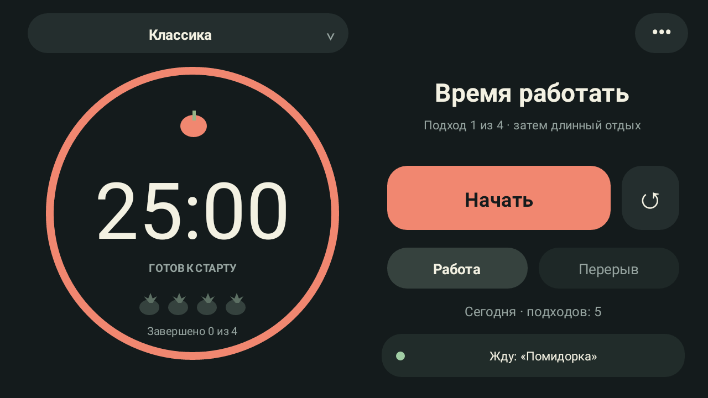
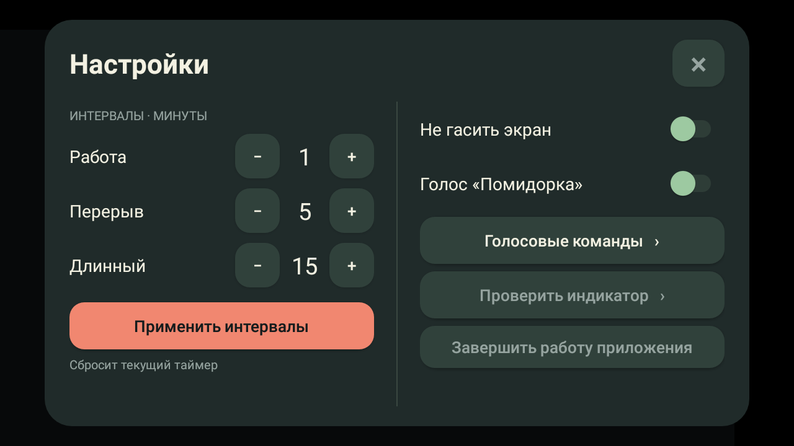
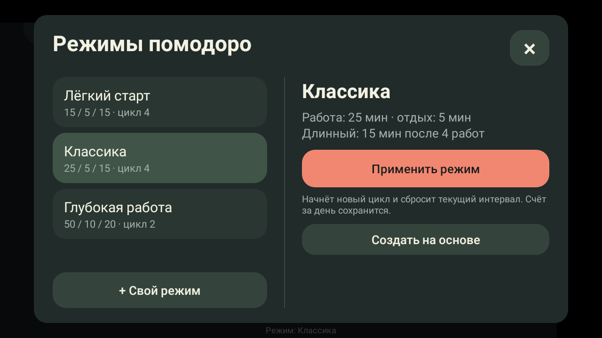
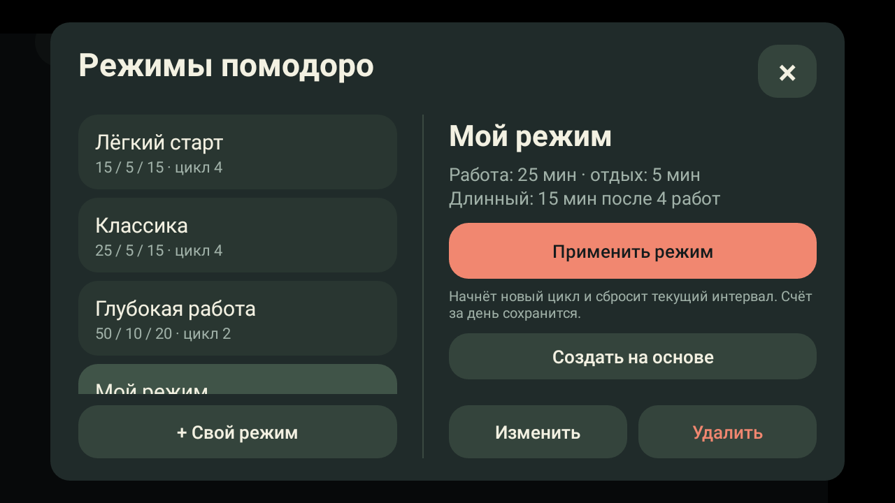

# Honor Pomodoro

A fullscreen, offline Pomodoro timer that gives an old **Honor 6A** a new job as a dedicated desk companion.

Built and tested on **Honor DLI-TL20 · Android 7.0 · 2 GB RAM · ARMv7**. The interface and voice commands are intentionally **in Russian**; documentation is in English.

Current version: **0.6.0** — reset the interval or the whole cycle from the tomato; no daily or lifetime statistics.

Installed on the Honor and accepted for daily desk use on 2026-10-30. A follow-up review found no app crashes or ANRs in the retained logs, with offline listening still active after about seven hours of captured audio. See [validation notes](VALIDATION.md) for measurements and remaining checks.



*Earlier device screenshot (0.5.0). In 0.6.0 the separate reset button and session statistics are removed; tap the tomato above the countdown to reset.*

## Features

- Landscape fullscreen UI. Swipe from an edge to temporarily reveal system navigation.
- The timer can appear over the lock screen. A recognized wake phrase or addressed command brings it forward and turns the display on, without dismissing the device lock (Android 7).
- Large countdown and a smooth progress ring: red for work, green for breaks.
- Tomato icons track completed work sessions in the selected cycle (1–8).
- One large Start/Pause button, resume, and manual work/break selection. Tap the tomato marked ↺ to choose **Reset interval** or **Reset entire cycle**.
- Built-in and custom presets define work, short/long rest, and the number of work sessions before a long rest.
- Five warning beeps during the final five seconds of work.
- Each completed stage opens a styled next-stage editor: minute stepper, quick presets, Start, and Later. Editing affects only the upcoming stage, not saved work/break durations.
- Independent persistent checkboxes control automatic starts: **rest on**, **work off** by default. An enabled automatic start waits ten seconds for a reply; editing cancels that countdown. The selected preset determines when a long rest is due.
- Optional screen-on mode, background timing, and completion sound. No daily/lifetime totals or session statistics are collected; only cycle progress is retained to schedule long rests. Previously saved totals are removed on upgrade.
- Offline Russian voice control activated by **«Помидорка»** (*pomidorka*, “little tomato”).
- Experimental notification LED controls.



## Resetting

Tap the tomato above the countdown to open the reset menu. **Сбросить интервал** restarts the current work/rest interval with its current duration (including a one-off override) and keeps cycle progress. **Сбросить весь цикл** clears cycle progress and any one-off override, and returns to the first work interval of the selected mode. Both leave the timer paused until Start; neither changes saved modes or auto-start settings. Cancel leaves the timer untouched.

## Presets

Tap the mode name at the top left of the timer, or open **Settings → Choose or create a mode**.

| Built-in mode | Work | Short rest | Long rest | Long rest after |
| --- | --- | --- | --- | --- |
| Лёгкий старт — Gentle start | 15 min | 5 min | 15 min | 4 work sessions |
| Классика — Classic | 25 min | 5 min | 15 min | 4 work sessions |
| Глубокая работа — Deep work | 50 min | 10 min | 20 min | 2 work sessions |

Selecting a card only previews it. **Apply mode** stops and resets the current interval, clears one-off time overrides, and starts a new cycle ready for work. Auto-start preferences remain global and are not changed by presets.

Use **+ Custom mode** to create your own, or **Create based on** to copy a built-in. Choose a name, three durations, and a cycle length of 1–8 work sessions. Save first, then apply separately. Custom modes can be edited and deleted; built-ins cannot be overwritten. Changes are stored locally and survive app restarts. Editing or deleting a saved definition does not alter an already applied timer configuration until another mode is explicitly applied.



Custom modes have fixed **Edit** and **Delete** buttons below the details. Deletion needs a second confirmation click.



## Voice commands

Enable voice using the bottom button or Settings, allow microphone access, and wait for **«Жду: Помидорка»**.

Say a complete phrase such as **«Помидорка, пауза»**, or say **«Помидорка»**, wait for the ready tone, and give a command.

| Russian command | Action |
| --- | --- |
| `начать работу` / `работа` | Select and start work |
| `старт` / `начать` / `запусти таймер` | Start or resume the selected interval |
| `пауза` | Pause |
| `продолжить` | Resume |
| `начать перерыв` / `перерыв` | Select and start a break |
| `сколько осталось` | Speak remaining minutes/seconds and show them on screen |
| `остановить таймер` / `стоп` | Pause and request reset confirmation |
| `подтверждаю` | Confirm a requested reset within 15 seconds |
| `отмена` | Cancel the request; the timer stays paused |

Confirm a reset with another addressed command: **«Помидорка, подтверждаю»**.

During the ten-second work-completion prompt, `да` / `нет` do not need the wake phrase. After rest, `старт` / `начать` can be spoken directly while the completion prompt is open. These direct replies require voice to be enabled. Outside these states normal commands require the wake phrase. Manual pause cancels any pending automatic transition. Process recreation never restores a pending auto-start decision.

In the next-stage editor, say **«Поменяй интервал на десять минут»** without the wake phrase. You may also say **«Поменяй интервал»**, then **«На десять минут»**. Recognizing the editing request cancels the automatic-start countdown; the new duration waits for an explicit Start/Yes. Whole minutes only: 1–120 for work, 1–60 for rest. A one-off duration survives pause/process recreation, then clears when that stage finishes or another stage is selected. Changing saved durations clears it too.

During a running interval, say **«Помидорка, поменяй интервал на пятнадцать минут»**. This sets **15 minutes remaining from the command**, not 15 minutes total including elapsed time. The current stage keeps running and is counted only once when finished. A paused stage remains paused. Saved work/break durations are unchanged. The two-step wake-phrase → ready tone → duration command also works.

**«Сделай интервал на пятнадцать минут»** is an equivalent duration command, including after the wake phrase during a running interval.

### Spoken remaining time

The remaining-time answer uses Android TextToSpeech with an **installed offline Russian voice**. It announces minutes and seconds, and mentions when the timer is paused. Recognition is temporarily gated while the app speaks, plus a short echo tail, so its answer is not treated as another command. A safety timeout releases the gate if the engine never reports completion.

The Honor's preinstalled Google TTS engine initially lacked Russian voice data. Install the Russian offline voice pack in Android's text-to-speech settings, then restart the app. The application does not download voices or select network-only voices. **Settings → Test spoken reply** reads the current remaining time without a microphone command. Its volume follows the media volume.

Voice uses **Vosk 0.3.75** and **vosk-model-small-ru-0.22**, restricted grammars, and a six-second command window. This is speech recognition with an addressed grammar, not a separately trained keyword detector. Only allowlisted complete commands execute. Misses and false activations are possible; single-phrase commands have not all been independently tested.

## Privacy and background behavior

The app has **no Internet permission**, accounts, analytics, or audio recording files. Its bundled recognition model is extracted into private app storage on first use. Spoken replies use the separately installed system voice engine and offline voice data.

Optional voice listening uses a foreground service, a visible notification, and a CPU wake lock. It consumes power; overnight use has not been measured. The microphone must be enabled manually after restart.

The running timer and displayed countdown use the same absolute monotonic deadline. UI snapshots are delivered inside the app process, avoiding queued Android background broadcasts. After process recreation, the saved interval returns **paused**, estimating remaining time from a saved wall-clock deadline. There is no boot autostart or guaranteed unattended alarm after reboot/force-stop.

## Build on Windows

Requirements:

- PowerShell 7
- JDK 17, with `java`, `javac`, `jar`, and `keytool` on `PATH`
- Android SDK **platforms;android-34**, **build-tools;34.0.0**, and **platform-tools**

No Gradle installation or neighboring project is required.

```powershell
git clone https://github.com/IavnFGV/honor-pomodoro.git
cd honor-pomodoro

# Download pinned dependencies and verify their SHA-256 hashes.
.\prepare-dependencies.ps1

# Test the timer engine, build the APK, and verify its signature.
.\test.ps1
.\build.ps1
```

Output: **`artifacts/pomodoro-honor-debug.apk`**.

First-time setup needs Internet access; the app does not. Downloads stay in ignored `.tools/`. A local test signing key is generated in ignored `.local/`. Keep this key to update existing installations with future builds. This is a development-signed APK, not a Play Store release.

Default SDK location: `%LOCALAPPDATA%\Android\Sdk`. Override it with:

```powershell
.\build.ps1 -AndroidSdk 'C:\Android\Sdk'
```

### Install

Enable USB debugging, connect and unlock the phone, then approve the computer's debugging key.

```powershell
.\install.ps1
# Optional explicit adb path:
.\install.ps1 -Adb 'C:\Android\Sdk\platform-tools\adb.exe'
```

The installer checks for an authorized **DLI-TL20** and targets it explicitly. The APK targets **API 24** and includes only **armeabi-v7a** native libraries. Other phones and Android versions have not been validated.

## Source layout

```text
AndroidManifest.xml           Permissions and landscape activity
src/local/ivand/pomodoro/     Timer, UI, settings, service, speech pipeline
res/drawable/                 Original vector tomato icon
tests/                       JVM timer tests
prepare-dependencies.ps1      Verified dependency downloads
build.ps1                     javac, D8, aapt2, zipalign, apksigner
install.ps1                   Model-specific USB installation
VALIDATION.md                 Measurements and test gaps
```

## Known limitations

- A captured ANR on the Honor blocked inside Android's hardware-accelerated renderer while opening the next-stage dialog. Version 0.4.0 disables hardware acceleration for this simple UI and removes its forced hardware layer. Follow-up device testing is described in the validation notes; long-term stability is not yet established.

- **LED operation is experimental.** The phone stayed green while charging despite a red request. A later patch adds vibration to prevent Android 7's silent-notification demotion; its physical result still needs verification. Completion alerts do not depend on LED operation.
- Long-term battery drain, thermal behavior, EMUI background survival, and false activations per hour have not been characterized.
- No task manager, cloud sync, or statistics export.
- This is an early device-focused prototype. See [validation notes](VALIDATION.md).

## License

Project source and original artwork use the [MIT License](LICENSE). Dependencies retain their own licenses: see [third-party notices](THIRD_PARTY_NOTICES.md).

Thanks to [Vosk](https://github.com/alphacep/vosk-api) and its [Russian model](https://alphacephei.com/vosk/models). No personal voice recordings or personal models are included in this repository.
